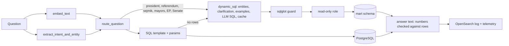

# Architecture

Plujka answers Polish election (PKW-style) questions with SQL against **PostgreSQL**: **LLM-written SQL over the relational `mart` schema** behind a parser guard and a read-only role ([MART.md](MART.md)), and **fixed SQL templates** for Sejm questions they cover. The answer text is either written by the LLM and checked number by number against the SQL rows, or a deterministic summary. Optional **OpenAI** writes SQL and answer text and improves intent extraction and embeddings; without it, the stack uses deterministic fallbacks.

## Request path (`POST /ask`)

1. **Embedding** — `embed_text(question)` for semantic fallback routing (and OpenSearch logging).
2. **LLM** — `extract_intent_and_entity(question)` proposes an intent and entity when OpenAI is configured; unknown intents fall back to semantic matching against predefined intent phrases.
3. **Router** — `route_question` in `api/services/router.py`. A question naming an election only the mart covers (president, referendum, sejmik, wójt/burmistrz, European Parliament, Senate) goes to `dynamic_sql` first. Otherwise the router resolves year(s) and location hints, picks `SQL_TEMPLATES[intent]`, binds parameters and runs `db.run_sql`; when the template returns nothing, `dynamic_sql.try_dynamic_query` takes over. It resolves entities against `mart.entity_lexicon` (returning `intent = "clarification"` with options when several people or same-name gminas match), adds similar verified examples, asks the LLM for one SELECT over `mart`, validates it with sqlglot and runs it as `plujka_mart_reader` (one repair attempt on error; validated SQL is cached per mart load). Telemetry is in `params._dynamic_sql_meta`.
4. **Answer** — `answer.compose_answer` turns the rows into Polish text. LLM text is used only when every number in it appears in the rows or the question; otherwise the answer is a summary built from the rows.
5. **Persistence and telemetry** — Results come from PostgreSQL only. Each request logs one line and one OpenSearch document with status, latency, row count, answer source and token usage (`api/services/opensearch_store.py`). `POST /ask` is rate-limited per client IP (`ASK_RATE_LIMIT_PER_MINUTE`, HTTP 429).

A clarification answer is sent back as `POST /ask` with `entity_refs: [{"kind": "person", "ref": "<person_id>"}]`; the Streamlit UI shows the options as buttons and does this for the user.

## Startup and data loading

On API startup (`lifespan` in `api/main.py`):

1. Production check — with `PLUJKA_ENV=production` the API refuses to start with the default database passwords or a disabled rate limit (otherwise it logs warnings).
2. `db.init_database()` — schema / migrations as implemented in `api/services/db.py`.
3. `opensearch_store.ensure_index()` — creates the `question_logs` index if missing; `examples.ensure_index()` creates the `sql_examples` index and indexes the curated examples (failures fall back to the curated file).

KBW rows are **not** imported by the API. Run the **`loader` service** (Compose profile `tools`): it stages mirror CSVs and the PKW bundles to Parquet, runs `scripts/import_kbw_facts.py` into `kbw_facts`, and finally `scripts/build_mart.py`, which builds the checked relational `mart` schema. That script **profiles the mirror tree into `kbw_dane_files`** first so `GET /kbw/catalog/summary` is meaningful after an import even when `kbw_facts` was empty before.

`GET /health` returns `data_ready: true` when `kbw_facts` has rows or the mart has loaded elections; `?details=true` lists the loaded elections (`mart_elections`). Streamlit polls `/health` so users see when the database has been populated.

`GET /kbw/catalog/summary` returns counts from `kbw_dane_files` (mirror inventory filled by `kbw_catalog.profile_kbw_dane_files`, typically from the loader). The Streamlit UI exposes catalog rollups and `GET /health?details=1` (`kbw_stats`) in collapsible `@st.fragment` sections that refresh on an interval so full-page reruns stay cheap.

## Question hints (`POST /question-hints`)

The Streamlit app calls this while the user types (≥ 2 characters) and after an answer to show **related past questions**. Responses combine **full-text** `match` on `question` and **kNN** on `question_embedding` (same 128-dim vectors as `log_question`). Short prefixes skip semantic search until `QUESTION_HINTS_SEMANTIC_MIN_CHARS` to limit embedding latency and OpenAI usage.

## Feedback (`POST /feedback`)

The Streamlit UI sends thumbs-up/down after each answer. A thumbs-up on a `dynamic_sql` answer also stores the question and its validated SQL as a few-shot example (`mart/examples.py`). **Thumbs-down** requests append one JSON line per event to `FEEDBACK_JSONL_PATH` (default `data/feedback/feedback.jsonl`) via `api/services/feedback_store.py`, including `needs_fix: true` and the full **`ask_response`** payload (question routing snapshot: `result`, `intent`, `sql`, `params`, etc.) for offline review. Thumbs-up lines omit `ask_response` and set `needs_fix: false`. In Docker, `./data` is mounted into the API container so logs land on the host under `data/feedback/`.

## Configuration

Central defaults and env vars are in `api/services/config.py` (`DATABASE_URL`, `MART_DATABASE_URL`, `MART_STATEMENT_TIMEOUT_MS`, `MART_MAX_ROWS`, `SQL_CACHE_*`, `SQL_EXAMPLES_*`, `ANSWER_SUMMARY_ENABLED`, `ASK_RATE_LIMIT_PER_MINUTE`, `PLUJKA_ENV`, `OPENSEARCH_URL`, OpenAI models, `EMBEDDING_DIM`, `FEEDBACK_JSONL_PATH`). See the table in [MART.md](MART.md#configuration). Docker Compose wires these for containers (see `docker-compose.yml`).

## Where to change behavior

| Concern              | Location                          |
| -------------------- | --------------------------------- |
| Intents / SQL shapes | `api/services/sql_templates.py`   |
| Routing rules        | `api/services/router.py`          |
| LLM SQL over `mart`  | `api/services/dynamic_sql.py`, `api/services/mart/safe_sql.py`, `api/services/mart/entities.py`, `api/services/mart/examples.py` |
| Answer text          | `api/services/answer.py`          |
| `mart` schema / build| `api/services/mart/`, `scripts/build_mart.py` |
| LLM prompts / parsing| `api/services/llm.py`             |
| Embeddings           | `api/services/embeddings.py`      |
| KBW import           | `api/services/kbw_import.py`, `scripts/import_kbw_facts.py`, `loader` service |
| Legacy PKW helpers   | `api/services/seed.py`            |
| UI                   | `streamlit_app/app.py`            |
| Feedback JSONL       | `api/services/feedback_store.py`  |
